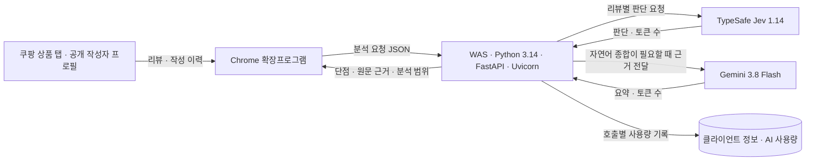

# ReviewAnaler MVP 위키

2026-11-12 기준 · 쿠팡 상품을 보는 Chrome 사용자 대상

**목표** 1~2점 리뷰에서 반복되는 상품 단점과 원문 근거 제시

## 전체 구조

- 확장프로그램 콘텐츠 스크립트에서 수집, 서비스 워커에서 WAS로 전송, 팝업에 결과 표시
- 배포 시 WAS 도메인 권한 부여 및 HTTPS 통신. [Chrome 콘텐츠 스크립트](https://developer.chrome.com/docs/extensions/develop/concepts/content-scripts) · [Chrome 네트워크 요청](https://developer.chrome.com/docs/extensions/develop/concepts/network-requests)
- WAS 설정은 `config.py`에서 관리, TypeSafe 키는 환경 변수 `TYPESAFE_API_KEY` 또는 `was/.env`에서 설정. [WAS 설정](was/src/was/config.py) · [TypeSafe System One API](https://docs.typesafe.ai/api/system-one) · [Gemini 모델 문서](https://ai.google.dev/gemini-api/docs/models/gemini-3.8-flash)

## 수집과 분석 흐름

| 단계 | MVP 계획 |
| --- | --- |
| 리뷰 표본 | 작성 빈도는 최신순·전체 별점, 단점 분석은 1~2점 표본 사용 |
| 수집 항목 | 상품·리뷰 ID, 별점, 작성일, 본문, 판매자, 옵션, 체험단 표시 중 확인 가능한 항목 |
| 공개 작성 이력 | 리뷰 ID와 판매 상품 ID로 작성자의 공개 다른 상품평을 조회. 관측 기간·건수 기준 작성 빈도와 별점 분포 계산은 후속 작업. 이력 1건 또는 조회 실패 시 작성자 판단 보류 및 본문 분석 유지 |
| 검토 신호 | 상품의 날짜별 리뷰 집중도와 작성자의 최근 작성 빈도 활용. 쿠팡의 체험단 표시, 관측 기간, 표본 수 병기 |
| 불만 분류 | Jev로 상품·옵션·배송 등 불만 범위 분류. 공개 이력이 충분하면 여러 상품의 구체적인 장단점 설명 참고 |
| 원문 근거 | WAS에서 근거 문장 후보 제공, 단점별 근거·리뷰 수 집계. 한국어 리뷰 표본으로 판단 기준 검증 |
| 자연어 요약 | 기본 응답은 Jev 결과, 필요시 Gemini에 근거 리뷰 전달 |
| 사용량 기록 | 호출별 클라이언트·요청 ID, 제공자, 실제 모델명, 입력·출력 토큰, 호출 시각 저장. 설치 ID는 클라이언트 식별자 후보, DB 엔진은 미정 |

## 현재 API

| 경로 | 동작 |
| --- | --- |
| `GET /health` | `ok`, `jev_configured` 반환. 실제 Jev 연결은 분석 요청으로 확인 |
| `POST /v1/reviews/analyze` | 1~2점 리뷰를 모아 기본 모델 `jev-1.14.0` 1회 호출. 1~2점 리뷰가 없으면 호출 생략 및 빈 판단 목록 반환 |

- **분석 요청** `product_id` 1~50자, `reviews[{rating, text}]` 1~8건, 별점 정수 1~5, 본문 1~3,000자. 상품 ID와 본문은 앞뒤 공백 제거 후 검증
- **선택 입력** 분석 리뷰의 ID·작성일·공개 작성자 ID·판매자·옵션·체험단 표시와, 별도 통계용 `review_sample`을 받을 수 있습니다. 본문 없는 표본은 별도 집계합니다.
- **응답** 상품 ID, 전체·1~2점 리뷰 수, 모델명, `usage.input_tokens`·`usage.output_tokens`, 리뷰별 판단. 제공 시 리뷰 ID와 표본 건수를 반환합니다.
- **리뷰별 판단** 입력 배열 인덱스(0부터), 단점 언급 확률, 불만 범위, 분류 신뢰도
- **불만 범위** 상품 자체, 구매 옵션, 배송·포장·판매자 서비스, 기타, 구체적 불만 미확인

[FastAPI 구현](was/src/was/__init__.py) · [WAS 오류 응답](was/review.md#was-오류-응답)

## 진행상황

| 항목 | 상태 |
| --- | --- |
| WAS · Jev | 독립 가상환경 구성. 모의 테스트 및 가상 리뷰로 실제 Jev 호출 확인. [WAS 검증 기록](was/review.md) |
| Chrome 확장프로그램 | 개발자 모드에서 로드 가능. 팝업에서 WAS로 분석 요청 전송 확인. [프론트엔드 테스트 기록](fe/review.md) |
| 쿠팡 리뷰 수집 | 사용자 Chrome의 상품 탭에서 수집·표시·분석 선택 확인. [쿠팡 조회 결과](fe/review.md#쿠팡-리뷰-조회) |
| 분석 확장 | 리뷰 메타데이터 및 통계 표본 입력 추가. 사용자 Chrome에서 실제 쿠팡 저별점 리뷰 1건의 WAS·Jev 분석과 결과 표시 확인. 작성자의 다른 상품평 조회와 이전·다음 이동도 사용자 Chrome에서 확인. 작성 빈도 계산, 원문 근거 선택·단점별 집계 대기 |
| 결과 화면 · 배포 | 결과 화면 확장, Gemini 요약, DB 저장, Chrome 웹 스토어 배포 대기 |

## 실행

- 로컬 WAS 기본 주소 `127.0.0.1:8765`. [WAS 실행·키 설정·검증](was/README.md)
- [Chrome 확장프로그램 설치·검증](fe/README.md)
